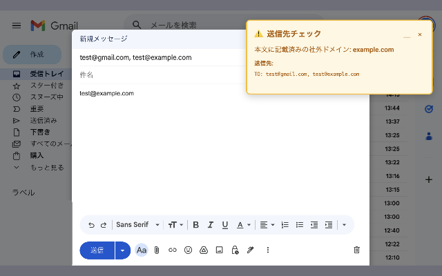
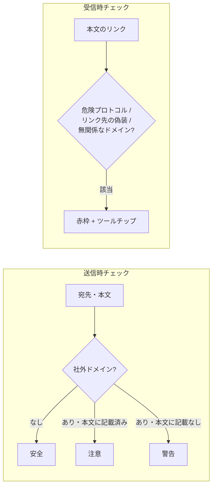

# Gmail 誤送信・フィッシング対策 Chrome 拡張機能

Gmail でメール作成時に送信先のドメインをリアルタイムでチェックし、社外ドメインが含まれている場合に段階的な警告を表示するほか、**受信メール内のリンクが偽装・無関係ドメイン・危険プロトコルを含まないか**もチェックする Chrome 拡張機能です。

## ✨ 主要機能

- **送信時チェック**: 宛先（To / CC / BCC）に社外ドメインがあると、安全・注意・警告の 3 段階で表示します。厳格モードでは、本文に `@ドメイン` 形式で書かれていない社外ドメインを「警告」にします。→ [送信時チェック](docs/send-check.md)
- **受信時チェック**: 受信メールのリンクのうち、危険なプロトコル・表示と異なるリンク先・送信元と無関係なドメインを指すものに赤枠を付けます。→ [受信時チェック](docs/link-check.md)
- **組織での一括配布**: Google Workspace の管理コンソールから社内ドメインや警告レベルを配布・固定できます。→ [組織での一括配布](docs/admin-policy.md)

## 使い始め方

1. 拡張機能をインストールする（ソースからのインストールは [開発ガイド](docs/development.md#ローカルへのインストール) を参照）
2. ツールバーのアイコンから設定画面を開き、**社内ドメイン**を登録する（例: `company.com, subsidiary.co.jp`）
3. Gmail でメールを作成すると、宛先に応じて警告が表示される

設定項目の詳細は [設定](docs/settings.md) を参照してください。

## ドキュメント

| ドキュメント | 対象 | 内容 |
|---|---|---|
| [送信時チェック](docs/send-check.md) | 利用者 | 判定の流れ、警告レベル、表示の切り替え、動作例 |
| [受信時チェック](docs/link-check.md) | 利用者 | リンク判定の流れ、検出パターン |
| [設定](docs/settings.md) | 利用者 | 設定画面の項目と警告レベル |
| [組織での一括配布](docs/admin-policy.md) | 管理者 | Google Workspace でのポリシー配布手順 |
| [開発ガイド](docs/development.md) | 開発者 | 開発環境、ビルド、構成 |
| [更新履歴](CHANGELOG.md) | すべて | バージョンごとの変更内容 |

## 🛡️ セキュリティとプライバシー

- **ローカル処理**: すべての判定処理はローカルで実行
- **データ送信なし**: メール内容は外部サーバーに送信されません
- **最小権限**: 必要最小限の Chrome 権限のみを要求
  - `storage`: 設定データの保存

## ⚠️ 注意事項・制限事項

### 技術的制限

- **Gmail 依存**: Gmail の DOM 構造に依存しているため、Gmail の更新により動作しなくなる可能性があります
- **新しい Gmail UI**: 現在は新しい Gmail UI に対応していますが、旧 UI では動作しません
- **言語対応**: 現在は日本語 UI の Gmail での動作を想定しています
- **複数の作成画面**: 作成画面を同時に複数開いている場合、作成画面ごとの判定には対応していません（詳細は [送信時チェック](docs/send-check.md#作成画面を複数開いている場合既知の制限)）

### 使用上の注意

- **完全な防止ではない**: 本拡張機能は注意喚起を目的としており、100%の誤送信防止を保証するものではありません
- **最終判断はユーザー**: 送信の最終判断は必ずユーザーが行ってください
- **定期的な設定確認**: 社内ドメインの変更時は設定を更新してください

## 🤝 貢献・フィードバック

- **Issue 報告**: バグや改善要望は [Issues](https://github.com/cti1650/gmail_address_checker/issues) まで
- **プルリクエスト**: 機能追加や修正のプルリクエストを歓迎します
- **使用感レポート**: 実際の使用感や改善提案をお聞かせください

## 📄 ライセンス

MIT License - 詳細は `LICENSE` ファイルをご確認ください。

---

**⚠️ 免責事項**: 本拡張機能の使用により発生したいかなる損害についても、作者は責任を負いません。ご理解の上でご使用ください。
