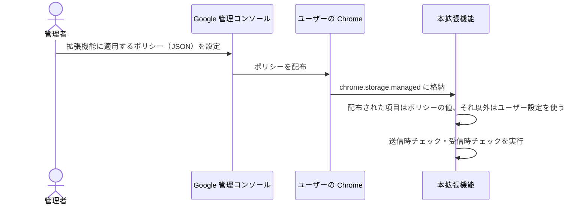

# 組織での一括配布（Google Workspace / Chrome Enterprise）

管理者は、社内ドメインや警告レベルなどの設定をポリシーで組織内のユーザーに配布できます。各ユーザーが自分で設定しなくても正しく判定できるようになり、ユーザーが警告を無効にすることも防げます。

- 対応ブラウザ: Chrome、Edge（Firefox は未対応）
- **配布した項目は、その値で固定されます。** 設定画面では操作できなくなり、「組織の設定で固定されています」と表示されます
- 配布しなかった項目は、これまでどおりユーザーが変更できます

## 仕組み



## 前提

管理コンソールでポリシーを設定するには、拡張機能を ID で指定できる必要があります。Chrome ウェブストアで公開するか、自前でホスティングして配布してください。ローカルで読み込んだだけの拡張機能（デベロッパーモード）には配布できません。

## 設定手順

1. Google 管理コンソールで **[デバイス] > [Chrome] > [アプリと拡張機能] > [ユーザーとブラウザ]** を開く
2. 対象の組織部門を選び、本拡張機能を追加する（強制インストール推奨）
3. 拡張機能の詳細パネルの **[拡張機能に適用するポリシー]** に次の JSON を設定する

```json
{
  "companyDomains": { "Value": ["example.com", "example.co.jp"] },
  "allowUserDomains": { "Value": false },
  "warningLevel": { "Value": "strict" },
  "extensionEnabled": { "Value": true },
  "linkCheckEnabled": { "Value": true }
}
```

必要な項目だけを書けば十分です。書かなかった項目はユーザーが変更できます。

## 設定できる項目

| キー | 型 | 内容 |
|---|---|---|
| `companyDomains` | 文字列の配列 | 社内として扱うメールドメインの一覧 |
| `allowUserDomains` | 真偽値 | `false` にすると、ユーザーは社内ドメインを追加できず、`companyDomains` だけで判定する。未指定または `true` なら、ユーザーが追加したドメインと合算する |
| `warningLevel` | `off` / `basic` / `strict` | 警告レベルをこの値に固定する |
| `extensionEnabled` | 真偽値 | 拡張機能の有効 / 無効をこの値に固定する |
| `linkCheckEnabled` | 真偽値 | 受信メールのリンクチェックの有効 / 無効をこの値に固定する |

### おすすめの設定

ユーザーが警告を止められないようにするには、次の組み合わせがおすすめです。

- `extensionEnabled: true` と `warningLevel: "strict"` で、警告を無効にできないようにする
- `allowUserDomains: false` で、ユーザーが `gmail.com` などを社内ドメインに追加して警告を消すのを防ぐ
- 拡張機能自体も管理コンソールで強制インストールにして、ブラウザから無効化・削除できないようにする

値の型が正しくない項目（例: `"false"` のような文字列）は、配布されていないものとして扱われます。

スキーマは [public/managed_schema.json](../public/managed_schema.json) で定義しています。

## 反映の確認

- ユーザーの Chrome で `chrome://policy` を開き、本拡張機能のポリシーに `companyDomains` が表示されていることを確認します。
- 拡張機能の設定画面で、配布したドメインが「組織で設定済み: …」と表示され、固定した項目に「組織の設定で固定されています」と表示されていれば反映済みです。
