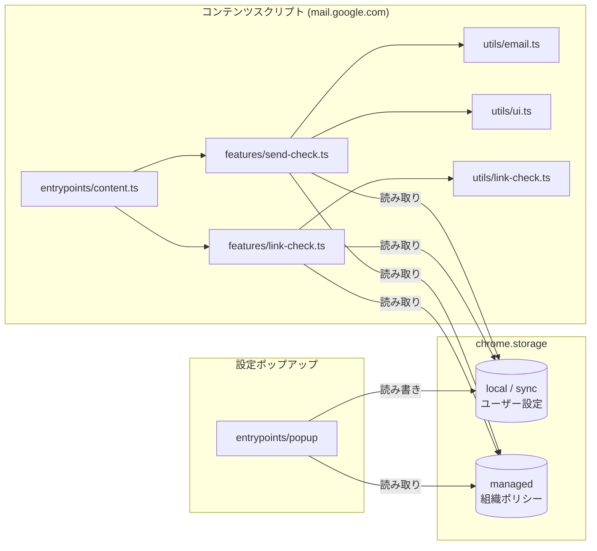

# 開発ガイド

## 必要な環境

- Node.js 25.2.1 以上（Volta で管理）
- npm 11.6.4 以上

## セットアップと開発

```bash
# 依存関係のインストール
npm install

# 開発モード（自動リロード）
npm run dev
npm run dev:chrome
npm run dev:firefox
```

## テスト・型チェック

```bash
npm run test:run     # テストを 1 回実行
npm test             # ウォッチモード
npm run typecheck    # 型チェック
```

## ビルド・配布

```bash
npm run build:chrome    # .output/chrome-mv3
npm run build:firefox   # .output/firefox-mv2

# 配布用 ZIP（.output/ に出力）
npm run zip:chrome
npm run zip:firefox
```

## ローカルへのインストール

**Chrome**

1. `npm run build:chrome` でビルド
2. `chrome://extensions/` を開き、「デベロッパーモード」を有効にする
3. 「パッケージ化されていない拡張機能を読み込む」で `.output/chrome-mv3` を指定

**Firefox**

1. `npm run build:firefox` でビルド
2. `about:debugging#/runtime/this-firefox` を開く
3. 「一時的なアドオンを読み込む」で `.output/firefox-mv2/manifest.json` を指定

## 技術スタック

- フレームワーク: WXT（Manifest V3）
- 言語: TypeScript
- ストレージ: @wxt-dev/storage（Chrome Storage API）
- ドメイン解析: tldts（Public Suffix List ベースの eTLD+1 判定）
- テスト: Vitest + happy-dom

## 構成



設定の読み書きは [utils/storage.ts](../utils/storage.ts) に集約しています。判定処理は `getEffective*` 関数を通して設定を読み、組織ポリシーで配布された項目はユーザー設定より優先されます。

### ディレクトリ構成

```
entrypoints/
  content.ts          # コンテンツスクリプトのエントリ (薄いオーケストレーター)
  popup/              # 設定ポップアップ
features/
  send-check.ts       # 送信時チェック機能 (コンポーズ画面監視 + 警告UI)
  link-check.ts       # 受信時リンクチェック機能 (DOM スキャン + ツールチップ)
utils/
  link-check.ts       # リンク判定の純関数ロジック (tldts ベース)
  email.ts            # 送信側のドメイン抽出ロジック
  ui.ts               # 共通 UI ヘルパー
  storage.ts          # 設定の永続化定義 (組織ポリシー配布分の読み込みを含む)
  managed-policy.ts   # 組織ポリシーの検証と、ポリシー優先の設定値の解決 (純関数)
  company-domains.ts  # ポリシー配布分とユーザー設定分の社内ドメイン合算
public/
  managed_schema.json # 組織ポリシー (chrome.storage.managed) のスキーマ
test/                 # Vitest のテスト
```

## 実装上の工夫

- **状態の一元管理**: 送信時チェックの表示状態は UIState オブジェクトで管理し、状態が変わったときだけ UI を更新する
- **再判定の抑制**: チェック済みのリンクには `data-gmail-link-checked` 属性を付け、再スキャンしない
- **リソースの自動解放**: `setTimeout` / `setInterval` / `addEventListener` / MutationObserver はすべて WXT の `ContentScriptContext` 経由で登録し、拡張機能のリロード時に自動で解放する
- **ツールチップの配置**: `position: fixed` で `document.body` 直下に置き、Gmail の `overflow: hidden` なコンテナで切れないようにしている
- **エラー処理**: 拡張機能の更新時に起きる "Extension context invalidated" に対応
