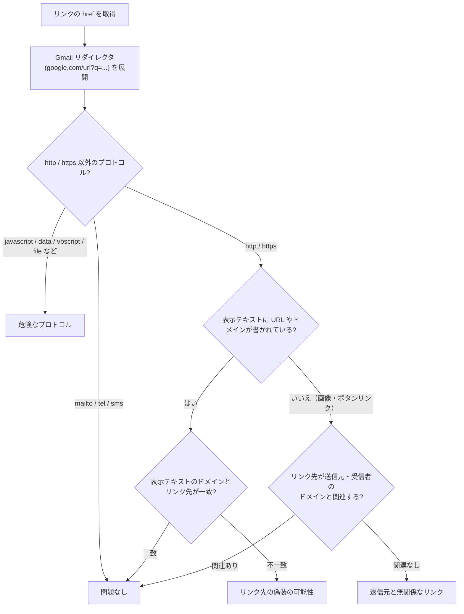

# 受信時チェック（リンク警告）

受信メールを開くと、本文内のリンク（`<a>` 要素）を自動でスキャンし、不審なリンクに赤枠を表示します。リンクにマウスを乗せると、理由を示すツールチップが表示されます。

設定画面の「受信メールのリンクチェック」で有効 / 無効を切り替えられます。

## 判定の流れ



## 検出パターン

| パターン | 内容 |
|---|---|
| 危険なプロトコル | `javascript:`、`data:`、`vbscript:`、`file:` などの非 HTTP プロトコル。Gmail リダイレクタで包まれていても展開して検知する |
| リンク先の偽装の可能性 | 表示テキストに `https://example.com` のような URL があるのに、実際のリンク先が別のドメイン |
| 送信元と無関係なリンク | 表示テキストに URL がない画像リンク・ボタンリンクで、リンク先が送信元・受信者のドメインと無関係 |

## ドメインの比べ方

- 登録可能ドメイン（eTLD+1）単位で比較します。判定には [tldts](https://github.com/remusao/tldts)（Public Suffix List）を使います。
  - 同じドメインのサブドメイン同士は同一とみなします（`mail.example.com` と `support.example.com`）。
  - `.co.jp`、`.co.uk` などの多段 TLD も正しく扱います。
- 「関連ドメイン」は、Gmail が各メッセージに付ける `[email]` 属性（送信者・受信者）から自動で取り出します。

## ツールチップ

```
┌──────────────────────────────┐
│ ⚠️ 送信元と無関係なリンク     │
├──────────────────────────────┤
│ リンク先  evil.com           │
│ 関連      example.com         │
└──────────────────────────────┘
```
