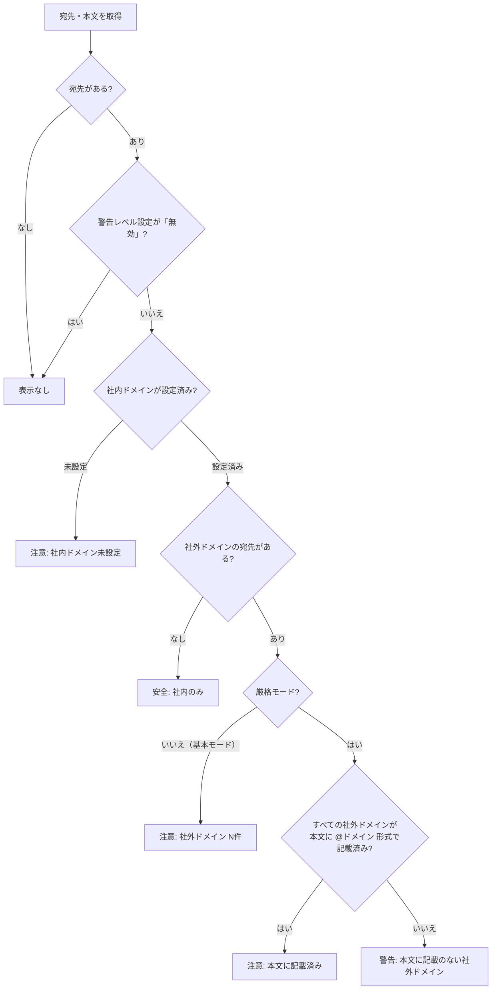
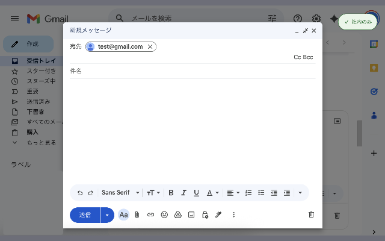
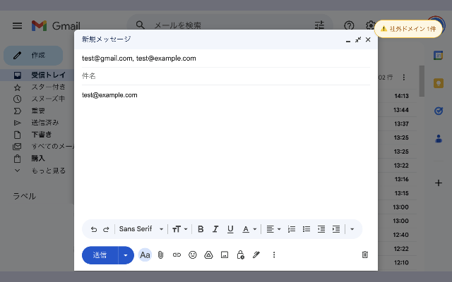
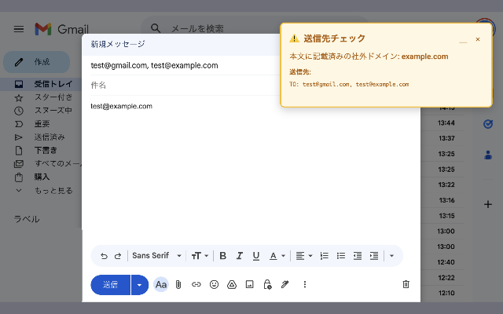
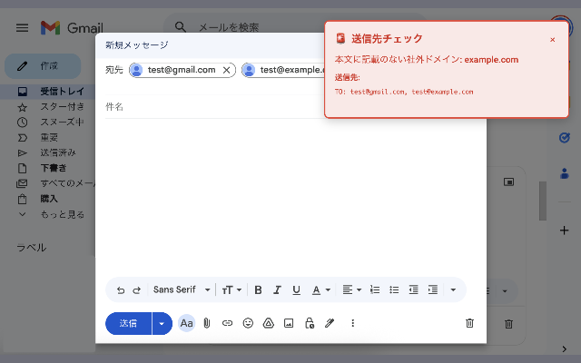
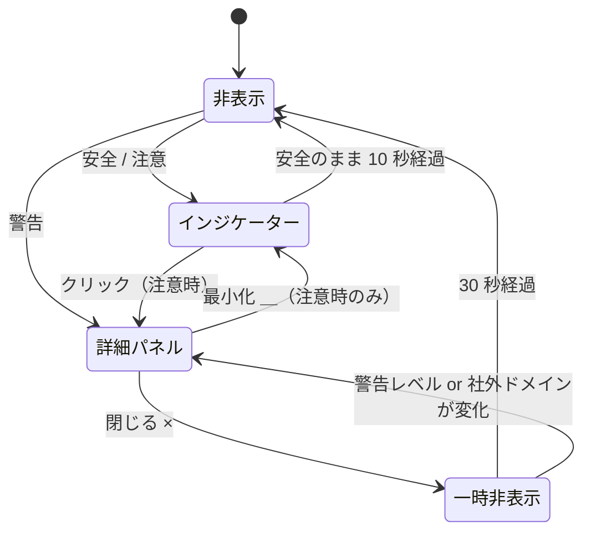

# 送信時チェック

Gmail のメール作成画面で宛先（To / CC / BCC）と本文を監視し、社外ドメインが含まれている場合に段階的な警告を表示します。

## 監視の仕組み

- Gmail 画面の変化（宛先の入力、作成画面の開閉など）を検知してチェックします。変化が続いても、チェックは 0.3 秒に 1 回までにまとめます
- 画面に変化がなくても、1 秒ごとにチェックします

### 作成画面を複数開いている場合（既知の制限）

宛先は開いているすべての作成画面のものをまとめて判定し、本文チェックには最初に見つかった作成画面の本文を使います。作成画面ごとの判定には対応していないため、複数の作成画面を同時に開いているときは警告の内容が正確でない場合があります。

## 判定の流れ



社内ドメインは、ユーザーが設定画面で登録したものと、組織ポリシーで配布されたもの（[組織での一括配布](admin-policy.md)）を合算して使います。管理者がユーザーによる追加を禁止している場合は、配布されたものだけを使います。警告レベルも、管理者が固定している場合はその値で判定します。

## 警告レベル

| レベル | 条件 | 表示 |
|---|---|---|
| 安全 | 宛先がすべて社内ドメイン | 画面右上に小さなインジケーター。10 秒で自動的に消える |
| 注意 | 社外ドメインあり（本文に記載済み、または基本モード）、社内ドメイン未設定 | インジケーター。クリックで詳細パネルを開く |
| 警告 | 本文に記載のない社外ドメインあり（厳格モードのみ） | すぐに詳細パネルを表示 |

| 安全 | 注意 | 注意（詳細を開いたとき） | 警告 |
|---|---|---|---|
|  |  |  |  |

## 本文チェック（厳格モード）

本文に社外ドメインが `@ドメイン` 形式で書かれている場合は、意図して送っているものと判断し、警告を「注意」に下げます。URL の記載は対象外です。

| 本文の記載 | 判定 |
|---|---|
| `support@example.com`、`info@example.com` | 記載ありとみなす |
| `https://www.example.com`、`example.com のサイト` | 記載ありとみなさない |

## 表示の切り替え



- **最小化（＿）**: 詳細パネルをインジケーターに戻します。注意レベルのときだけ表示されます。
- **閉じる（×）**: 30 秒間非表示にします。その間に警告レベルや社外ドメインの組み合わせが変わると、すぐに再表示されます。

## 動作例

社内ドメインに `company.com, internal.local, subsidiary.co.jp` を設定した場合の例です。

**安全なケース**

```
宛先: team@company.com, support@internal.local
結果: ✓ 社内のみ - 10秒で自動非表示
```

**注意が必要なケース（厳格モード）**

```
宛先: partner@example.com
本文: 「support@example.com 宛に連絡します」
結果: ⚠️ 社外ドメイン 1件 - クリックで詳細表示
```

**警告が必要なケース（厳格モード）**

```
宛先: partner@example.com
本文: 「https://www.example.com を確認してください」
結果: 🚨 本文に記載のない社外ドメイン: example.com - 即座に詳細パネル表示
```

**基本モードの場合**

```
宛先: partner@example.com
本文: 任意の内容
結果: ⚠️ 社外ドメイン 1件 - 本文チェックは行わない
```
