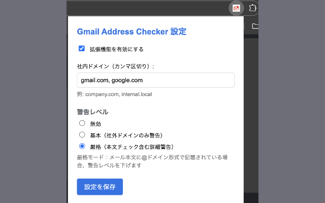

# 設定

ツールバーの拡張機能アイコンをクリックすると設定画面が開きます。

## 設定項目

| 項目 | 内容 | 初期値 |
|---|---|---|
| 拡張機能の有効 / 無効 | 送信時チェック・受信時チェックの両方をまとめてオン / オフ | 有効 |
| 受信メールのリンクチェック | [受信時チェック](link-check.md) だけのオン / オフ | 有効 |
| 社内ドメイン | 社内として扱うドメイン。カンマ区切りで複数指定（例: `company.com, internal.local`） | 未設定 |
| リンクチェックで信頼するドメイン | リンク先がこれらのドメインなら、受信時チェックで警告しない。カンマ区切りで複数指定。社内ドメインは自動で信頼される（詳しくは [受信時チェック](link-check.md#信頼するドメイン)） | 未設定 |
| 警告レベル | 無効 / 基本 / 厳格 | 厳格 |

社内ドメインが未設定のままだと、宛先を入れるたびに「社内ドメイン未設定」の注意が表示されます。最初に設定してください。

## 組織の管理者が設定を配布している場合

組織の管理者がポリシーで設定を配布していると、次のように表示されます。詳しくは [組織での一括配布](admin-policy.md) を参照してください。

- 配布された社内ドメインと信頼するドメインは、入力欄の下に「組織で設定済み: …」と表示されます。自分で入力したドメインと合算して判定に使われます。
- 管理者が固定した項目は操作できず、「組織の設定で固定されています」と表示されます。
- ドメインの追加が禁止されている場合は社内ドメインと信頼するドメインの入力欄が使えず、配布されたドメインだけで判定されます。

## 警告レベル

| 設定 | 動作 |
|---|---|
| 無効 | すべての警告を表示しない |
| 基本 | 社外ドメインがあれば「注意」を表示。本文チェックはしない |
| 厳格 | 本文チェックを含めて判定し、本文に記載のない社外ドメインは「警告」にする（推奨） |

判定の詳細は [送信時チェック](send-check.md) を参照してください。
